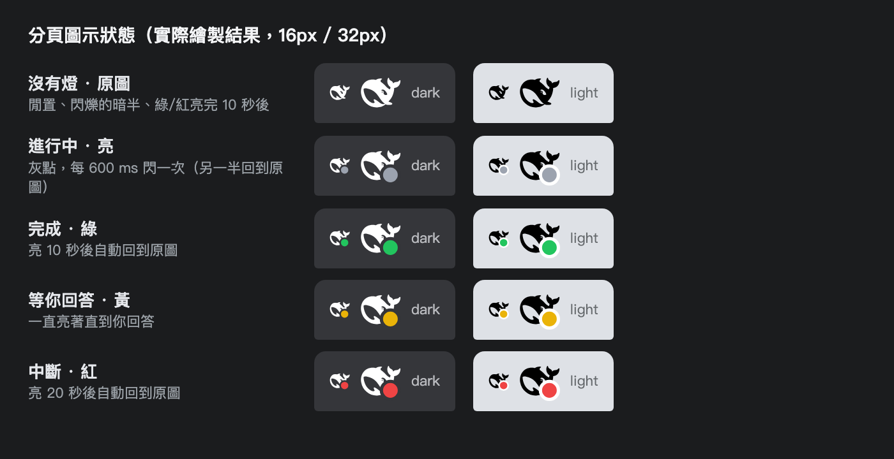

# dsh-tab-status-light

**把 AI 的狀態畫在瀏覽器分頁圖示上** —— 一個給 DeepSeek Harness Web UI 用的外掛。

> Puts the AI session state on the browser tab icon: gray blinking while it works,
> green when it finishes, yellow while it waits for you, red when it is interrupted.



| 狀態 | 顏色 | 動畫 | 判定依據 |
| --- | --- | --- | --- |
| 進行中 | 灰 `#9ca3af` | 一閃一閃（每 600 ms 切換）：**原本的鯨魚** ↔ 鯨魚+灰點，暗的那半完全沒有圓點 | `SessionStatus.running === true` |
| 完成 | 綠 `#22c55e` | 亮 10 秒後自動回到原本的鯨魚 | 這一輪**被看到在跑**，且最後一個 `turn/end` reason 不是中斷類 |
| 等你回答 | 黃 `#eab308` | 一直亮著（因為在等你） | `SessionStatus.pendingInteraction !== undefined`（提問 / 核准 / 計畫審查） |
| 中斷 | 紅 `#ef4444` | 亮 20 秒後自動回到原本的鯨魚 | 這一輪**被看到在跑**，且最後一個 `turn/end` reason 是 `aborted` / `blocked` / `error` / `interrupted` |

沒選 session（首頁）、該 session 還沒有任何一輪結束、或只是**切換到一個早就結束的 session** 時，
**不動**原本的鯨魚圖示 —— 綠／紅是「剛剛發生的事」的通知，不會從歷史重播。
「一小段時間沒事就收起來」的行為由 `SETTLE_MS`（綠 10 秒）與 `SETTLE_MS_RED`（紅 20 秒）控制；
任何新的一輪結束都會讓燈重新亮起。

## 安裝

外掛以 DSH bundle 的形式發佈（`dsh.bundle.patch`），用 harness 的 `plugin_manager` 安裝：

```js
plugin_manager({ action: "install_bundle", target: "dsh-tab-status-light" })
```

或直接指到這個資料夾（開發時這樣最快，改檔後重新整理即生效）：

```js
plugin_manager({ action: "install_bundle", target: "/path/to/dsh-tab-status-light" })
```

安裝後重新整理頁面（`Cmd+R`）即可看到分頁圖示變化。

> 需要 harness 的 Web profile，且 `@deepseek-ai/dsh-client-ui-session` 與
> `@deepseek-ai/dsh-api-session-controller` 兩個 Client 套件可用（標準安裝即有）。

## 運作方式

- **純 Client 外掛、不佔用任何 slot**：讀 `ctx.sessions.list`（哪個 session 是主視窗）與
  `ctx.uiSession.sessionStatus`（running / pendingInteraction），並訂閱該 session 的
  event source 取得最新的 `turn/end` reason。
- 圖示是**即時重繪**的：用 `fetch()` 讀取原本的 `favicon.svg` / `favicon-dark.svg`，
  在 `</svg>` 前插入一顆 `<circle>`，轉成 data URL 後換掉 `<link rel="icon">` 的 `href`
  （Chrome 會跟著重畫分頁圖示）。unmount 時還原原始 href。
- 因此鯨魚圖案不會被複製一份到外掛裡，上游之後換 logo 也會自動跟上。
- 圓點幾何（在 50×50 viewBox 內）：`cx=37, cy=37, r=11, stroke-width=4`；
  外圈用分頁底色（深色主題 `#35363a`、淺色主題 `#ffffff`）把圓點跟鯨魚隔開。
- 閃爍由一個小型 Web Worker 計時驅動，**分頁切到背景時照樣閃**（繞開 Chrome 對背景
  分頁 `setInterval` 的節流）；不支援 Worker 時自動退回頁面計時器。

## 可調參數

都在 [`client.js`](client.js) 檔頭：

| 常數 | 預設 | 說明 |
| --- | --- | --- |
| `BADGE` | `{cx:37, cy:37, radius:11, ring:4}` | 圓點位置 / 半徑 / 外圈寬 |
| `BADGE_COLOR` | 灰 / 綠 / 黃 / 紅 | 四種狀態的顏色 |
| `BLINK_MS` | `600` | 灰燈閃爍間隔（每 600 ms 切換一次） |
| `SETTLE_MS` | `10000` | 綠燈亮多久後收回 |
| `SETTLE_MS_RED` | `20000` | 紅燈亮多久後收回 |
| `RED_TURN_END_KINDS` | `aborted` `blocked` `error` `interrupted` | 哪些結束原因算中斷 |

## 資源用量

閃爍中的 JS 成本約 **2 ms/秒**（單核約 0.2%）；閒置時 0（沒有計時器、沒有重新掃描）。

## 已知限制

- 圖示由「主視窗」那個 session 決定；其他背景 session 的狀態不會顯示。
- 切換到一個「早就跑完」的 session 不會亮綠燈（只亮真的看到跑完的那一輪）。
- 分頁在背景時仍會閃爍；極端省電模式下（例如 Chrome Memory Saver 把分頁凍結）可能被暫停。
- 用純 SVG data URL 換 href，不支援 SVG favicon 的瀏覽器（很舊的）會看不到變化。

## 開發

```js
// 這個 repo 就是可直接安裝的 bundle 資料夾，沒有 build step
plugin_manager({ action: "install_bundle", target: "/absolute/path/to/dsh-tab-status-light" })
```

改完 `client.js` 後在瀏覽器重新載入頁面即可生效（Client 模組是即時從磁碟供應的）。

## License

[MIT](LICENSE)
